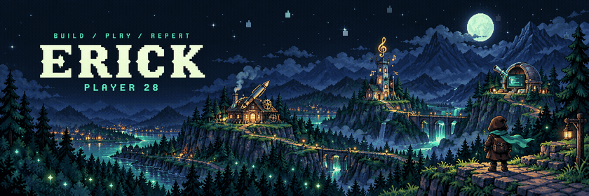

  <picture>
    <source media="(prefers-reduced-motion: reduce)" srcset="assets/aventura.png">
    
  </picture>

<strong>Soy Erick. Creo herramientas para el día a día.</strong> IA local, automatización, música y proyectos que salen de la pantalla.

Clase: Artífice · Tres caminos: crear, explorar y aprender.

  <picture>
    <source media="(prefers-color-scheme: dark)" srcset="assets/jugador-dark.svg">
    
  </picture>

## Misiones

**[Pluma A1](https://github.com/erickopgaming28/pluma-a1)** · La forja del Artífice 
Editor local en español para preparar escritura y dibujos con una Bambu Lab A1. 
`Python` · `SVG` · `Trazado`

**[Clasificador de Música](https://github.com/erickopgaming28/clasificador-de-musica)** · La torre del Bardo 
Organiza música de Spotify por género, ánimo y ocasión, y crea playlists. IA opcional. 
`JavaScript` · `Node.js` · `Spotify API`

**[AI Token Monitor](https://github.com/erickopgaming28/ai-token-monitor)** · El observatorio 
Consulta el consumo de tokens por proyecto, con historial local y estimaciones de costo. 
`Python` · `PySide6` · `SQLite`

## Logros

  <picture>
    <source media="(prefers-color-scheme: dark)" srcset="assets/logro-explorador-dark.svg">
    
  </picture>
  <picture>
    <source media="(prefers-color-scheme: dark)" srcset="assets/logro-multiclase-dark.svg">
    
  </picture>
  <picture>
    <source media="(prefers-color-scheme: dark)" srcset="assets/logro-estrella-dark.svg">
    
  </picture>

Los logros y la experiencia se calculan con [datos públicos del perfil](assets/progreso.json).

<strong>Abrir árbol de habilidades</strong>

Tres caminos para construir cosas útiles: **Arcanista**, **Bardo** y **Artífice**.

  <picture>
    <source media="(max-width: 600px) and (prefers-color-scheme: dark)" srcset="assets/habilidades-mobile-dark.svg">
    <source media="(max-width: 600px)" srcset="assets/habilidades-mobile-light.svg">
    <source media="(prefers-color-scheme: dark)" srcset="assets/habilidades-dark.svg">
    
  </picture>

Las ramas muestran áreas de mis proyectos; no representan porcentajes de dominio.

<strong>Inventario de herramientas</strong>

| En la mochila | Para qué lo uso |
|---|---|
| Python | Automatización, datos y herramientas locales. |
| JavaScript y Node.js | Integraciones y aplicaciones como el clasificador de música. |
| SQLite | Guardar el historial y consultar datos en el equipo. |
| PySide6 | Interfaces de escritorio. |
| SVG | Diseños y trazos que pueden salir al papel. |
| Spotify API | Organizar música y construir playlists. |

Cada herramienta aparece en los proyectos de arriba. El inventario describe usos; no son puntuaciones de habilidad.

<strong>Nivel, experiencia y estadísticas</strong>

<!-- PLAYER:START -->
**Nivel 05 · 425 XP** · 4 repositorios públicos · 1 estrella recibida. Faltan **75 XP** para el nivel 06.
<!-- PLAYER:END -->

Cada repositorio público propio aporta **100 XP** y cada estrella recibida aporta **25 XP**. Se excluyen este perfil y los forks. La aventura empieza en el nivel 1 y sube un nivel por cada 100 XP.

Es un sistema lúdico basado solo en datos públicos. Se recalcula al ejecutar **Actualizar ficha RPG** o al cambiar su generador.

[Actualizar progreso](https://github.com/erickopgaming28/erickopgaming28/actions/workflows/perfil.yml) · [Ver la captura](assets/progreso.json) · [Personalizar](docs/PERSONALIZAR.md)

---

  <picture>
    <source media="(prefers-color-scheme: dark)" srcset="assets/campamento-dark.svg">
    
  </picture>

**Mi forma de jugar:** empezar con un problema real, construir algo que pueda usar y mejorarlo con las pruebas. Interfaces claras y control sobre mis datos.

[Explorar todos los repositorios →](https://github.com/erickopgaming28?tab=repositories) · [Proponer una misión](https://github.com/erickopgaming28/erickopgaming28/issues/new?title=Nueva%20misi%C3%B3n)
